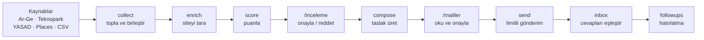

# StajBot

**Staj başvurusunu baştan sona yöneten kişisel otomasyon aracı.** Şirketleri herkese açık kaynaklardan toplar, web sitelerini tarayıp puanlar, her şirkete özel başvuru maili hazırlar, senin onayınla kontrollü biçimde gönderir ve gelen cevapları takip eder.


Bilgisayar mühendisliği 4. sınıfta **İşyeri Mesleki Eğitim** (uzun dönem, yüz yüze staj) yeri ararken yüzlerce şirketin sitesini tek tek gezmek, mail adresi bulmak ve her birine ayrı mail yazmak yerine bu süreci otomatikleştirmek için yazıldı. Kendi staj başvurularımda gerçekten kullanıyorum.

---

## Öne çıkanlar

- 🔎 **Çok kaynaklı toplama:** Sanayi Bakanlığı Ar-Ge / Tasarım Merkezleri listesi, ~20 teknoparkın firma rehberi, YASAD / TÜBİSAD üye listeleri, Google Places ve CSV/XLSX. Aynı şirket farklı kaynaklardan gelse de tek kayıtta birleşir.
- 🌐 **Zenginleştirme:** Şirket sitesini tarayıp İK / kariyer mail adreslerini, teknoloji yığınını, kariyer sayfasını, staj ilanını ve büyüklük ipuçlarını çıkarır. `robots.txt`'e uyar, istekler arasında bekler.
- 📊 **Puanlama:** Her şirkete 0–100 puan verir: staj ilanı, Ar-Ge merkezi, teknopark, okul protokolü, İK maili, profilinle örtüşen teknolojiler…
- ✉️ **Kişiye özel mailler:** Sektöre göre seçilen şablon (kurumsal, savunma, oyun, girişim…) ve şirkete özel "neden siz" paragrafı. İstenirse paragrafı LLM (Anthropic Claude) yazar, uydurma bilgi kullanmaz.
- 🛡️ **Kontrollü gönderim:** Hiçbir mail onaysız gitmez. Günlük limit, mesai saati penceresi, gönderimler arası rastgele bekleme ve aynı şirkete 14 gün kuralı vardır.
- 📥 **Cevap takibi:** Gelen kutusunu IMAP ile okur, cevapları Message-ID, `[BV-0042]` takip kodu ve domain üzerinden şirkete eşleştirir. Otomatik yanıtları ve **ulaşmayan mailleri** (bounce) ayırt eder, olumlu / olumsuz tahmini yapar.
- 🗂️ **Zaman çizelgesi:** Her şirketin bulunmasından teklife kadar tüm aşamaları web arayüzünde tek sayfada görürsün.

## Nasıl çalışır



Şirket durumu şu yolu izler: `Bulundu → Hazır → Taslak → Gönderildi → Cevap geldi / Cevap yok / Mail ulaşmadı → Mülakat → Teklif`. Sistemin değiştirdiği durumlar ile senin elle işaretlediğin aşamalar (telefon, mülakat, teklif) ayrı tutulur.

---

## Hızlı başlangıç

Gereksinimler: Python 3.13 ve bir Gmail hesabı. Windows 11'de geliştirildi; Linux ve macOS'ta da çalışır.

```powershell
git clone https://github.com/Efe184/stajbot.git
cd stajbot
python -m venv .venv
.venv\Scripts\python -m pip install -r requirements.txt
copy .env.example .env            # bilgilerini doldur
.venv\Scripts\python -m stajbot init-db
```

> Linux / macOS'ta `.venv\Scripts\python` yerine `.venv/bin/python`, `copy` yerine `cp` kullan.

### Hazır şirket listesi

Repo, herkese açık kaynaklardan derlenmiş **4.792 şirketlik** bir liste içerir: [`data/sirketler.csv`](data/sirketler.csv). Listede yalnızca kurumsal mail adresleri (ik@, info@, kariyer@…) var, kişisel adresler çıkarıldı. Toplama adımını atlamak istersen:

```powershell
.venv\Scripts\python -m stajbot import-csv data\sirketler.csv --allow-non-target
```

`--allow-non-target` olmadan yalnızca `.env`'deki hedef şehirlerdeki şirketler alınır.

### Web arayüzü

```powershell
.venv\Scripts\python -m stajbot serve      # http://127.0.0.1:8000
```

Kurulumu önce `MAIL_MODE=dry` (varsayılan) ile dene. Bu modda hiçbir mail gönderilmez, yalnızca ne yapılacağı loglanır.

---

## Günlük akış

```powershell
.venv\Scripts\python -m stajbot collect                       # 1. şirketleri topla
.venv\Scripts\python -m stajbot enrich --only-pending --limit 50   # 2. siteleri tara
.venv\Scripts\python -m stajbot score                         # 3. puanla
#                                                               4. /inceleme: onayla / reddet
.venv\Scripts\python -m stajbot compose --all-ready           # 5. taslak üret
#                                                               6. /mailler: oku, düzenle, onayla
.venv\Scripts\python -m stajbot send --dry-run                # 7. önce prova…
.venv\Scripts\python -m stajbot send                          #    …sonra gönder
.venv\Scripts\python -m stajbot inbox                         # 8. cevapları eşleştir
.venv\Scripts\python -m stajbot followups                     # 9. hatırlatma taslakları
```

Kurulumdan sonra her gün `inbox` ve `send`, haftada bir de `followups` çalıştırmak yeterli.

<details>
<summary><b>Tüm komutlar</b></summary>

| Komut | Açıklama |
|---|---|
| `init-db` | Veritabanı tablolarını oluşturur (`data/stajbot.db`) |
| `collect [--source argem\|teknopark\|bilisim500\|google_places\|all] [--city X]... [--allow-non-target]` | Kaynaklardan toplar ve birleştirerek kaydeder. Bir kaynak hata verirse diğerleriyle devam eder |
| `import-csv DOSYA [--source csv\|school] [--city VARSAYILAN] [--allow-non-target]` | CSV / XLSX içe aktarır (UTF-8 / cp1254, Türkçe başlıklar olur). `--print-template` şablonu yazdırır |
| `enrich [--limit N] [--only-pending] [--company-id N]` | Web sitelerini tarar |
| `score` | Tüm puanları yeniden hesaplar |
| `compose (--company-id N \| --all-ready) [--no-llm] [--limit N]` | Başvuru taslağı üretir (göndermez) |
| `send [--dry-run] [--force] [--limit N]` | Onaylı taslakları gönderir. `--force` yalnızca mesai saati kontrolünü aşar, limiti aşmaz |
| `inbox` | IMAP'tan yeni mesajları alır ve şirketlere eşleştirir |
| `followups [--limit N]` | Süresi dolanları "Cevap yok" yapar ve hatırlatma taslağı üretir |
| `serve [--host] [--port] [--reload]` | Web arayüzü |
| `stats` | Sayıların Türkçe özeti |

</details>

<details>
<summary><b>Web arayüzü sayfaları</b></summary>

| Sayfa | İçerik |
|---|---|
| `/` | Pano: durum sayıları, bekleyen onaylar, bugün gönderilenler, sahipsiz mailler, yaklaşan hatırlatmalar |
| `/sirketler` | Filtrelenebilir liste (şehir, durum, büyüklük, kaynak, puan), arama, CSV dışa aktarma |
| `/sirketler/{id}` | Şirket kartı: kişiler, kaynaklar, zaman çizelgesi, mailler, durum ve not düzenleme |
| `/inceleme` | Puana göre sıralı onay kuyruğu |
| `/mailler` | Taslakları düzenle, paragrafı yeniden üret, onayla; gönderimi başlat |
| `/gelen` | Eşleşen ve sahipsiz mailler; cevap tahminini onayla |
| `/istatistik` | Kaynak / şehir / sektör bazında gönderim ve cevap oranları |
| `/ayarlar` | Ayar özeti (gizli değerler maskeli) ve profil düzenleme |

</details>

---

## Yapılandırma

Tüm ayarlar `.env` dosyasındadır (`.env.example`'dan kopyala). Bu dosya şifre içerir ve `.gitignore`'dadır.

<details>
<summary><b><code>.env</code> alanları</b></summary>

| Alan | Açıklama |
|---|---|
| `USER_FULL_NAME`, `USER_PHONE`, `USER_SCHOOL`, `USER_DEPARTMENT`, `USER_CLASS` | Maillerde kullanılan kimlik bilgileri |
| `INTERNSHIP_TERM`, `INTERNSHIP_START`, `INTERNSHIP_END` | Staj dönemi, örn. `2026-2027 Bahar`, `2027-01-25`, `2027-05-14`. Tarihler maile otomatik yazılır |
| `TARGET_CITIES` | Hedef şehirler (virgülle). Boşsa varsayılan 10 şehir |
| `MAIL_MODE` | `dry` (yalnızca logla) / `draft` (Gmail taslağına koy) / `send` (gerçekten gönder) |
| `MAIL_USER`, `MAIL_PASSWORD`, `MAIL_FROM_NAME` | Gmail adresi ve **uygulama şifresi** |
| `DAILY_SEND_LIMIT`, `SEND_DELAY_MIN_SEC`, `SEND_DELAY_MAX_SEC` | Günlük limit (varsayılan 15) ve gönderimler arası bekleme |
| `SEND_WINDOW`, `SEND_WEEKDAYS_ONLY` | Mesai penceresi (`09:00-17:30`) ve yalnızca hafta içi |
| `FOLLOWUP_DAYS`, `MIN_DAYS_BETWEEN_MAILS` | Hatırlatma süresi (10 gün) ve aynı şirkete iki mail arası en az gün (14) |
| `ATTACHMENTS` | Maile eklenecek dosyalar (örn. CV) |
| `GOOGLE_PLACES_API_KEY` | İsteğe bağlı, Google Places kaynağı için |
| `ANTHROPIC_API_KEY`, `LLM_MODEL` | İsteğe bağlı, kişiye özel paragraf için |
| `LOG_LEVEL`, `DB_PATH`, `DATA_DIR`, `PROFILE_PATH`, `HTTP_TIMEOUT_SEC`, `LLM_MAX_TOKENS` | İleri ayarlar |

Profilini (okul, bildiğin teknolojiler, projeler) `data/profil.example.md`'den kopyaladığın `data/profil.md` dosyasına yaz. Web arayüzündeki `/ayarlar` sayfasından da düzenleyebilirsin.

</details>

<details>
<summary><b>Gmail uygulama şifresi</b> (<code>draft</code> / <code>send</code> modu ve <code>inbox</code> için gerekli)</summary>

Gmail, SMTP / IMAP girişi için normal şifreyi kabul etmez.

1. Google hesabında **2 Adımlı Doğrulama**'yı aç: <https://myaccount.google.com/security>
2. **Uygulama şifreleri** sayfasında `StajBot` adıyla şifre oluştur: <https://myaccount.google.com/apppasswords>
3. 16 haneli şifreyi boşluksuz olarak `.env`'de `MAIL_PASSWORD=` satırına yaz.
4. Gmail ayarlarında IMAP'ın açık olduğundan emin ol.
5. Önce `MAIL_MODE=draft` ile dene. Taslaklar Gmail'in Taslaklar klasörüne düşer. Her şey doğruysa `send`'e geç.

</details>

<details>
<summary><b>Google Places ve Anthropic anahtarları</b> (isteğe bağlı)</summary>

**Google Places (New):** Google Cloud Console'da proje aç, faturalandırma bağla, **Places API (New)**'yu etkinleştir, anahtarı yalnızca bu API ile kısıtla ve bir bütçe uyarısı tanımla. Tam bir tarama yaklaşık 250 istektir. Ayda ~1000 istek ücretsizdir ve yanıtlar 7 gün önbellekte tutulur. Anahtar yoksa bu kaynak uyarıyla atlanır.

**Anthropic:** "Neden bu şirket" paragrafını LLM'e yazdırmak için <https://console.anthropic.com>'dan anahtar al. Anahtar yoksa ya da `compose --no-llm` kullanırsan şablonun sabit paragrafı kullanılır.

</details>

<details>
<summary><b>Kaynaklarla ilgili notlar</b></summary>

- **argem:** sanayi.gov.tr otomatik indirmeyi engelleyebilir. Komut önce `data/argem/*.xlsx` dosyalarına bakar, yoksa Wayback Machine'den indirmeyi dener.
- **teknopark:** Her teknoparkın sitesi için ayrı okuyucu vardır (`stajbot/collectors/teknoparklar.yaml`). Bot korumalı siteler için listeyi CSV ile içe aktar.
- **bilisim500:** Bilişim 500 listesi ücretlidir. YASAD ve TÜBİSAD üye listeleri ücretsiz taranır.
- **google_places:** Anahtar yoksa atlanır. İstek bütçesi ve önbellek vardır.

</details>

<details>
<summary><b>CSV içe aktarma şablonu</b></summary>

`python -m stajbot import-csv --print-template` şablonu yazdırır. Dosya UTF-8 olmalı. Ayraç virgül, noktalı virgül ya da sekme olabilir. Yalnızca `name` zorunludur, başlıklar Türkçe de yazılabilir (`Şirket Adı`, `Web Sitesi`, `E-posta`, `Şehir`…).

```csv
name,website,email,city,district,address,phone,sector,description,contact_name,tags,notes
Örnek Yazılım A.Ş.,https://www.ornekyazilim.com,kariyer@ornekyazilim.com,İstanbul,Maslak,,0212 000 00 00,Fintech,Ödeme sistemleri geliştirir,,"fintech;odeme",Okul listesinden
```

`--source school` ile alınan şirketler okul protokolü olarak işaretlenir ve +25 puan alır. Aynı dosyayı tekrar içe aktarmak kayıt çoğaltmaz, yalnızca boş alanları doldurur.

</details>

---

## Güvenlik ve nezaket

- **Onay olmadan mail gitmez.** Taslaklar web arayüzünde tek tek onaylanır, gönderim ayrıca başlatılır.
- **Spam gibi görünmez.** Günlük limit, mesai saati, 2–6 dakika rastgele bekleme ve aynı şirkete 14 gün kuralı vardır. Kara listedeki ya da süreci kapanmış şirketlere asla mail gitmez.
- **Ulaşmayan mailler ayıklanır.** Bounce gelen adreslere hatırlatma gönderilmez.
- **Toplayıcılar saygılıdır.** `robots.txt`'e uyar, istekler arasında bekler ve kendini User-Agent ile tanıtır.
- **Kişisel veri repoda yok.** `.env`, veritabanı, CV ve profil `.gitignore`'dadır.
- **Son söz senin.** Cevap tahminleri yalnızca tahmindir. LLM paragrafını göndermeden önce her taslağı oku.

---

## Proje yapısı

```
stajbot/
├── collectors/   # Ar-Ge, teknopark, YASAD/TÜBİSAD, Google Places, CSV + birleştirme
├── enrich/       # site tarama, anahtar kelimeler, puanlama
├── mail/         # şablonlar, taslak üretimi, LLM, SMTP gönderim, IMAP, cevap eşleştirme
├── web/          # FastAPI + Jinja2 + HTMX arayüzü
├── models.py     # SQLAlchemy modelleri
├── enums.py      # durumlar ve izin verilen geçişler
├── services.py   # iş kuralları
└── cli.py        # Typer komutları
tests/            # 686 test, ağ gerektirmeyen fikstürlerle
```

Modül sınırları ve veri modeli için [`MIMARI.md`](MIMARI.md) dosyasına bak.

## Geliştirme

```powershell
.venv\Scripts\python -m pytest -q              # ağ gerektirmeyen testler
.venv\Scripts\python -m pytest -q -m network   # canlı sitelere çıkan testler
```

**Teknolojiler:** Python 3.13 · FastAPI · Jinja2 · HTMX · Pico.css · SQLAlchemy 2 · SQLite · httpx · selectolax · Typer · Anthropic SDK · pytest · respx

Proje, yapay zekâ destekli bir kodlama aracıyla (Claude Code) birlikte geliştirildi.
